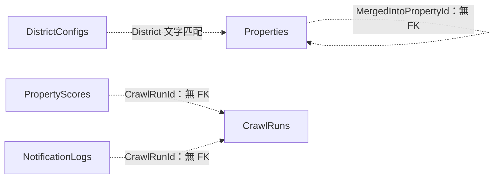

# HouseLens ER Model 與資料字典

更新日期：2026-10-31  
資料庫：Supabase PostgreSQL；應用程式預設 schema：`houselens`  
模型版本：`20261030174622_InitialPostgresql`（EF Core 10.0.9）

本文件依目前的 EF Core 模型、PostgreSQL migration 與服務程式整理，描述資料結構與現有讀寫行為，不代表每張表目前都有資料。

## 1. 資料表清單

HouseLens 使用 **11 張業務資料表，加上 1 張 EF Core migration 紀錄表**，共 12 張。Supabase 自身的 Auth、Storage 等系統資料表不在本文件範圍。

| 資料表（均位於 houselens） | 用途 |
|---|---|
| `Properties` | 房屋主檔 |
| `Listings` | 平台刊登資料 |
| `PriceHistoryEntries` | 價格觀測紀錄 |
| `CrawlRuns` | 爬取輪次 |
| `SourceRunResults` | 各平台爬取結果 |
| `PropertyScores` | 物件評分明細 |
| `NotificationLogs` | 通知處理紀錄 |
| `DistrictConfigs` | 各地區爬取條件 |
| `PlatformFilterConfigs` | 平台專屬篩選條件 |
| `TrackingCriteria` | 全域追蹤條件／回退設定 |
| `ScoringConfigs` | 評分與大降價門檻 |
| `__EFMigrationsHistory` | EF Core 已套用的資料庫結構版本 |

## 2. 閱讀方式與資料慣例

- `PK` 是主鍵；`FK` 是資料庫實際建立的外鍵。「邏輯參照」僅由程式使用，資料庫不保證參照對象存在。
- 表名與欄位保留大小寫。手寫 SQL 應使用例如 `houselens."Properties"`、`"CurrentTotalPrice"` 的雙引號識別名稱。
- 總價及降價金額的單位為**萬元**；單價為**萬元／坪**；面積為**坪**；屋齡為**年**。
- 比例用小數儲存：`0.05` = 5%，`-0.05` = -5%，不是直接儲存數字 5。
- `timestamptz` 是 `timestamp with time zone` 的簡寫。應用程式以 UTC 寫入；PostgreSQL 依連線時區顯示，並不保存原始時區名稱。
- `varchar(n)` 是 `character varying(n)` 的簡寫；`numeric(p,s)` 表示總共 p 位、其中 s 位小數。
- Enum 欄位目前使用 `integer`，沒有建立 PostgreSQL enum 型別或合法值的 CHECK 約束。
- UUID 主鍵由應用程式的 `Guid.NewGuid()` 產生；四張設定表使用 `GENERATED BY DEFAULT AS IDENTITY` 整數主鍵。
- 下文的「預設值」若標為 Entity／seed，屬於 C# 初始化或 seed 寫入，**不是 SQL DEFAULT**。目前業務欄位除 identity 外沒有 migration 宣告的伺服器端預設值；直接 INSERT 必須自行供應必要欄位。
- NOT NULL 只保證不是 NULL，不等於非空字串或業務值合法；例如權重範圍、正價格、JSON 格式仍由程式處理。

## 3. ER 圖：資料庫實際外鍵

下圖僅畫出實際 FK。所有子表都有獨立主鍵，因此使用 Mermaid 的「非識別關聯」虛線；`||` 表示恰好一筆父資料，`o{` 表示零至多筆子資料。圖中只顯示主要欄位；第 5 節列出全部欄位。

```mermaid
erDiagram
    Properties ||..o{ Listings : "PropertyId / CASCADE"
    Properties ||..o{ PriceHistoryEntries : "PropertyId / CASCADE"
    Properties ||..o{ PropertyScores : "PropertyId / CASCADE"
    CrawlRuns ||..o{ PriceHistoryEntries : "CrawlRunId / RESTRICT"
    CrawlRuns ||..o{ SourceRunResults : "CrawlRunId / CASCADE"

    Properties {
        uuid Id PK
        varchar City
        varchar District
        numeric CurrentTotalPrice
        numeric Score
        integer Status
        uuid MergedIntoPropertyId "logical reference only"
    }
    Listings {
        uuid Id PK
        uuid PropertyId FK
        integer SourceSite
        varchar SourceListingKey "composite unique with SourceSite"
        numeric LatestSourcePrice
    }
    PriceHistoryEntries {
        uuid Id PK
        uuid PropertyId FK
        uuid CrawlRunId FK
        integer SourceSite "composite unique with PropertyId and CrawlRunId"
        numeric TotalPrice
        timestamptz CapturedAt
    }
    CrawlRuns {
        uuid Id PK
        timestamptz StartedAt
        timestamptz FinishedAt
        integer Status
    }
    SourceRunResults {
        uuid Id PK
        uuid CrawlRunId FK
        integer SourceSite
        boolean Success
        integer FetchedCount
    }
    PropertyScores {
        uuid Id PK
        uuid PropertyId FK
        uuid CrawlRunId "no FK to CrawlRuns"
        numeric Score
    }
    NotificationLogs {
        uuid Id PK
        uuid CrawlRunId "no FK to CrawlRuns"
        varchar Type
        boolean Success
    }
    DistrictConfigs {
        integer Id PK
        varchar City
        varchar District "composite unique with City"
        numeric MaxTotalPrice
        boolean IsEnabled
    }
    PlatformFilterConfigs {
        integer Id PK
        integer SourceSite UK
        numeric MinSizePing
        varchar Rooms
        varchar TypeCodes
    }
    TrackingCriteria {
        integer Id PK
        text Districts "JSON string"
        numeric MaxTotalPrice
    }
    ScoringConfigs {
        integer Id PK
        numeric WeightUnitPrice
        numeric WeightAge
        numeric WeightParking
        numeric WeightLocation
        numeric BigDropPercent
        numeric BigDropAmount
    }
    __EFMigrationsHistory {
        varchar MigrationId PK
        varchar ProductVersion
    }
```



## 4. 關聯與刪除規則

### 4.1 實體外鍵（共 5 條）

所有以下 FK 欄位皆為 NOT NULL；子資料必須有存在的父資料。父資料可以沒有子資料。

| 子表欄位 | 參照目標 | 父 → 子 | 刪除父資料時 |
|---|---|---|---|
| `Listings.PropertyId` | `Properties.Id` | 1 → 0..N | CASCADE：刪除刊登資料 |
| `PriceHistoryEntries.PropertyId` | `Properties.Id` | 1 → 0..N | CASCADE：刪除價格歷史 |
| `PropertyScores.PropertyId` | `Properties.Id` | 1 → 0..N | CASCADE：刪除評分明細 |
| `PriceHistoryEntries.CrawlRunId` | `CrawlRuns.Id` | 1 → 0..N | RESTRICT：仍有價格歷史時，拒絕刪除輪次 |
| `SourceRunResults.CrawlRunId` | `CrawlRuns.Id` | 1 → 0..N | CASCADE：刪除平台執行結果 |

例如刪除一筆 `Properties`，會連帶刪除其 Listings、PriceHistoryEntries 與 PropertyScores；不會刪除 CrawlRuns。刪除 CrawlRun 前須先處理 PriceHistoryEntries。

### 4.2 邏輯關聯：沒有外鍵約束

| 參照／匹配方式 | 用途 | 資料庫不會自動做的事 |
|---|---|---|
| `Properties.MergedIntoPropertyId → Properties.Id` | 表示某物件被合併到另一主物件；欄位可空 | 不保證目標存在，也不防止自指或循環 |
| `PropertyScores.CrawlRunId → CrawlRuns.Id` | 表示評分所屬輪次 | 不檢查輪次存在，不隨輪次自動刪除 |
| `NotificationLogs.CrawlRunId → CrawlRuns.Id` | 表示通知所屬輪次 | 不檢查輪次存在，不隨輪次自動刪除 |
| `DistrictConfigs.District ↔ Properties.District` | 目前爬蟲以行政區名稱建立條件及比對，City 不參與這個匹配鍵 | 沒有 DistrictConfigId，不會隨地區改名自動更新房屋 |
| `PlatformFilterConfigs.SourceSite ↔ 各來源平台代碼` | 以共同的 SourceSite enum 取得爬蟲篩選條件 | Listings 等表不必先有平台設定列才能寫入 |
| `TrackingCriteria.Districts ↔ 行政區名稱` | 分析、通知及爬蟲回退使用的地區清單 | 不會與 DistrictConfigs 自動同步，也不是多對多關聯表 |



## 5. 完整欄位字典

下表「可空」是 migration 的 NULL 設定；「鍵／參照」中沒有標示的欄位不代表沒有一般索引，索引另列於第 7 節。

### 5.1 `Properties` — 房屋主檔

以去重後的房屋物件為單位，保存跨平台共用的基本資料、目前價格、狀態與目前評分。一個物件可對應多筆平台刊登。

| 欄位 | PostgreSQL 型別 | 可空 | 鍵／參照 | 作用與說明 |
|---|---|---|---|---|
| `Id` | `uuid` | 否 | PK | 物件識別碼；由應用程式以 Guid.NewGuid() 產生。 |
| `City` | `varchar(20)` | 否 | — | 縣市名稱，例如「新北市」。 |
| `District` | `varchar(20)` | 否 | — | 行政區名稱，例如「中和區」；用於篩選、統計與評分分組。 |
| `Address` | `varchar(200)` | 是 | — | 正規化後的地址；來源不足時可為 NULL。 |
| `AreaPing` | `numeric(10,2)` | 否 | — | 面積，單位為坪。 |
| `Floor` | `varchar(20)` | 是 | — | 樓層文字，保留來源可提供的表示方式。 |
| `AgeYears` | `integer` | 是 | — | 屋齡，單位為年；未知時為 NULL。 |
| `HasParking` | `boolean` | 否 | — | 是否有車位；目前是布林值，不能區分「未知」與「沒有」。 |
| `CurrentTotalPrice` | `numeric(12,2)` | 否 | — | 主檔目前總價，單位為萬元；由爬取／去重流程維護，不保證永遠是所有刊登的最低價。 |
| `CurrentUnitPrice` | `numeric(12,2)` | 是 | — | 主檔目前單價，單位為萬元／坪；未知時為 NULL。 |
| `Status` | `integer` | 否 | — | 物件狀態：0 Active、1 Delisted、2 Merged；見列舉對照。 |
| `Score` | `numeric(5,4)` | 是 | — | 目前綜合評分；尚未評分時為 NULL，正常權重下為 0～1，保留四位小數。 |
| `IsNew` | `boolean` | 否 | — | 本輪新物件標記；建立新主檔時設 true，下一輪開始時清除先前 active 物件的新物件標記。 |
| `FirstSeenAt` | `timestamptz` | 否 | — | 首次建立／發現時間，應用程式以 UTC 記錄。 |
| `LastSeenAt` | `timestamptz` | 否 | — | 最近一次觀測到物件的 UTC 時間。 |
| `MissingCount` | `integer` | 否 | — | 連續完整輪次未觀測到的次數；達 2 次時標為下架，重新觀測到時歸零。 |
| `MergedIntoPropertyId` | `uuid` | 是 | 邏輯參照（無 FK） | 被合併時指向主物件的 Id；可為 NULL，僅邏輯自我參照，沒有外鍵。 |

`Merged` 與 `MergedIntoPropertyId` 支援合併標記；目前爬蟲偵測跨平台重複時直接把新 Listing 掛到既有 Property，沒有呼叫 `PropertyMerger.MergeInto` 來建立被合併主檔紀錄。

### 5.2 `Listings` — 平台刊登資料

保存同一房屋在不同平台的來源身分、標題、連結與圖片。平台內的刊登鍵搭配平台代碼識別一筆來源。

| 欄位 | PostgreSQL 型別 | 可空 | 鍵／參照 | 作用與說明 |
|---|---|---|---|---|
| `Id` | `uuid` | 否 | PK | 刊登資料識別碼；應用程式產生 UUID。 |
| `PropertyId` | `uuid` | 否 | FK | 所屬房屋主檔 Id；實體外鍵，刪除主檔時一併刪除。 |
| `SourceSite` | `integer` | 否 | — | 來源平台整數代碼，見 SourceSite 對照。 |
| `SourceListingKey` | `varchar(100)` | 否 | — | 該平台提供的物件編號；與 SourceSite 組成複合唯一鍵。 |
| `Title` | `varchar(200)` | 否 | — | 平台刊登標題；不可為 NULL，但資料庫未禁止空字串。 |
| `Url` | `varchar(500)` | 否 | — | 原始刊登頁網址。 |
| `PostedDate` | `timestamptz` | 是 | — | 來源平台的刊登日期／時間；來源未提供或未解析時可為 NULL。 |
| `LatestSourcePrice` | `numeric(12,2)` | 否 | — | 來源開價欄位，單位為萬元；建立 Listing 時寫入。 |
| `IsActive` | `boolean` | 否 | — | 刊登是否有效；建立時應用程式預設 true。 |
| `ImageUrl` | `varchar(1000)` | 是 | — | 來源圖片網址；尚無圖片時為 NULL。 |

目前爬蟲更新既有刊登時，未同步刷新 `LatestSourcePrice` 或停用 `IsActive`。這兩欄不能單獨視為即時來源價格／下架狀態；目前物件價格與狀態主要看 `Properties`。

### 5.3 `PriceHistoryEntries` — 價格觀測紀錄

保存物件在特定爬取輪次、特定平台的價格與漲跌判斷，供歷史價格圖、降價查詢與通知使用。

| 欄位 | PostgreSQL 型別 | 可空 | 鍵／參照 | 作用與說明 |
|---|---|---|---|---|
| `Id` | `uuid` | 否 | PK | 價格紀錄識別碼；應用程式產生 UUID。 |
| `PropertyId` | `uuid` | 否 | FK | 所屬物件 Id；實體外鍵，刪除物件時一併刪除。 |
| `CrawlRunId` | `uuid` | 否 | FK | 產生這筆觀測的爬取輪次 Id；實體外鍵，有歷史紀錄時禁止直接刪除該輪次。 |
| `CapturedAt` | `timestamptz` | 否 | — | 記錄價格的 UTC 時間。 |
| `TotalPrice` | `numeric(12,2)` | 否 | — | 本次觀測總價，單位為萬元。 |
| `UnitPrice` | `numeric(12,2)` | 是 | — | 本次觀測單價，單位為萬元／坪；可為 NULL。 |
| `SourceSite` | `integer` | 否 | — | 本次觀測來源平台；與 PropertyId、CrawlRunId 組成複合唯一鍵。 |
| `ChangeFlag` | `integer` | 否 | — | 價格變動方向：0 None、1 Increased、2 Decreased。 |
| `ChangePercent` | `numeric(8,4)` | 是 | — | 帶正負號的價格變動比例；-0.05 代表降價 5%。沒有前價或價格未變時為 NULL。 |
| `IsBigDrop` | `boolean` | 否 | — | 是否符合大降價條件；必須為降價，且降幅或降價金額任一達門檻。 |

目前前價查詢取同一物件最近的 `CapturedAt`，沒有再以平台篩選，因此可能跨來源比較。同一 `(PropertyId, CrawlRunId, SourceSite)` 只存第一筆；新發現的跨平台重複刊登，在掛到既有物件後會提前返回，該路徑當次不新增價格歷史。

### 5.4 `CrawlRuns` — 爬取輪次

代表一次手動或排程觸發的爬取工作，保存開始／結束時間、執行狀態與處理計數。

| 欄位 | PostgreSQL 型別 | 可空 | 鍵／參照 | 作用與說明 |
|---|---|---|---|---|
| `Id` | `uuid` | 否 | PK | 爬取輪次識別碼；應用程式產生 UUID。 |
| `StartedAt` | `timestamptz` | 否 | — | 輪次開始的 UTC 時間。 |
| `FinishedAt` | `timestamptz` | 是 | — | 輪次結束時間欄位；目前流程正常完成時才填入 UTC 時間，失敗或中斷時可能仍為 NULL。 |
| `Status` | `integer` | 否 | — | 輪次狀態：0 Running、1 Completed、2 Failed。 |
| `NewCount` | `integer` | 否 | — | 流程累加的新建房屋主檔次數；新增跨平台重複 Listing 不算新主檔。 |
| `DelistedCount` | `integer` | 否 | — | 本輪完整下架判斷中，從 active 轉為 delisted 的物件數。 |
| `BigDropCount` | `integer` | 否 | — | 本輪偵測到大降價時的累加次數；不保證等於去重物件數或實際成功儲存的歷史列數。 |

輪次為 `Completed` 不代表所有平台都成功，應併看 `SourceRunResults.Success`。目前正式流程沒有將整輪狀態寫成 `Failed` 的程式路徑，因此整輪失敗／中斷後可能仍是 `Running` 且 `FinishedAt` 為 NULL。計數由流程累加，沒有資料庫觸發器負責與明細自動對帳。單一平台爬取不執行完整的未見物件下架掃描。

### 5.5 `SourceRunResults` — 各平台爬取結果

記錄一個爬取輪次中，每個來源平台的執行結果、處理筆數與錯誤，便於單平台失敗追蹤。

| 欄位 | PostgreSQL 型別 | 可空 | 鍵／參照 | 作用與說明 |
|---|---|---|---|---|
| `Id` | `uuid` | 否 | PK | 平台結果識別碼；應用程式產生 UUID。 |
| `CrawlRunId` | `uuid` | 否 | FK | 所屬爬取輪次；實體外鍵，刪除輪次時一併刪除。 |
| `SourceSite` | `integer` | 否 | — | 來源平台整數代碼。 |
| `Success` | `boolean` | 否 | — | 該平台爬取程序是否完成；逾時或拋出例外時為 false。 |
| `FetchedCount` | `integer` | 否 | — | 通過地區／價格條件篩選的 DTO 累加數，可能含重複資料或逐筆處理失敗的資料；不是成功新增列數。 |
| `ErrorMessage` | `varchar(1000)` | 是 | — | 平台執行錯誤或逾時說明；成功時通常為 NULL。 |

目前沒有 `(CrawlRunId, SourceSite)` 唯一約束；每輪每平台一筆是現有流程行為，不是資料庫強制規則。

### 5.6 `PropertyScores` — 物件評分明細

模型上用來保存物件於某輪次的綜合分數與各因子分數。現有爬蟲只更新 Properties.Score，尚未寫入這張明細表。

| 欄位 | PostgreSQL 型別 | 可空 | 鍵／參照 | 作用與說明 |
|---|---|---|---|---|
| `Id` | `uuid` | 否 | PK | 評分紀錄識別碼；應用程式產生 UUID。 |
| `PropertyId` | `uuid` | 否 | FK | 所屬物件 Id；實體外鍵，刪除物件時一併刪除。 |
| `CrawlRunId` | `uuid` | 否 | 邏輯參照（無 FK） | 評分所對應的輪次 Id；僅邏輯參照，沒有指向 CrawlRuns 的外鍵。 |
| `Score` | `numeric(5,4)` | 否 | — | 該次綜合評分，保留四位小數。 |
| `UnitPriceScore` | `numeric(5,4)` | 是 | — | 單價因子分數；缺乏可評分資料時可為 NULL。 |
| `AgeScore` | `numeric(5,4)` | 是 | — | 屋齡因子分數；未知屋齡時可為 NULL。 |
| `ParkingScore` | `numeric(5,4)` | 是 | — | 車位因子分數；欄位允許 NULL。 |
| `LocationScore` | `numeric(5,4)` | 是 | — | 地段因子分數；欄位允許 NULL。 |
| `CalculatedAt` | `timestamptz` | 否 | — | 評分計算的 UTC 時間。 |

沒有 `(PropertyId, CrawlRunId)` 唯一約束，也沒有以 ScoringConfigId 保存所用權重版本。不要因為有這張表，就假設目前已保留逐輪評分歷史。

### 5.7 `NotificationLogs` — 通知處理紀錄

保存每個爬取輪次的大降價及 Top 5 通知處理結果，供排程通知與錯誤追蹤使用。

| 欄位 | PostgreSQL 型別 | 可空 | 鍵／參照 | 作用與說明 |
|---|---|---|---|---|
| `Id` | `uuid` | 否 | PK | 通知紀錄識別碼；應用程式產生 UUID。 |
| `CrawlRunId` | `uuid` | 否 | 邏輯參照（無 FK） | 對應爬取輪次 Id；僅邏輯參照，沒有外鍵。 |
| `Type` | `varchar(50)` | 否 | — | 通知類別；目前程式寫入 BigDrop 或 Top5，是文字欄位而非 PostgreSQL enum。 |
| `Success` | `boolean` | 否 | — | 通知流程是否成功；無大降價而跳過發送也會記為 true，不能單憑此欄證明已送達。 |
| `ErrorMessage` | `varchar(1000)` | 是 | — | 捕捉到的通知例外訊息；可為 NULL。回傳失敗但未拋例外時，也可能沒有錯誤文字。 |
| `SentAt` | `timestamptz` | 否 | — | 通知紀錄物件建立時的 UTC 時間；不是 LINE 確認送達時間。 |

資料庫沒有 `(CrawlRunId, Type)` 唯一約束；重跑通知可能留下多筆紀錄。刪除 CrawlRun 不會由資料庫連帶刪除這張表的紀錄。

### 5.8 `DistrictConfigs` — 各地區爬取條件

設定各縣市／行政區是否追蹤、總價上限、屋齡及停車位需求。爬蟲優先讀取啟用的地區設定。

| 欄位 | PostgreSQL 型別 | 可空 | 鍵／參照 | 作用與說明 |
|---|---|---|---|---|
| `Id` | `integer` | 否 | PK | 整數主鍵；PostgreSQL GENERATED BY DEFAULT AS IDENTITY。 |
| `City` | `varchar(20)` | 否 | — | 縣市名稱；與 District 組成複合唯一鍵。 |
| `District` | `varchar(20)` | 否 | — | 行政區名稱；同一縣市內不可重複。 |
| `MaxTotalPrice` | `numeric(12,2)` | 否 | — | 該地區總價上限，單位為萬元；Entity 預設 800，seed 會依地區設定不同上限。 |
| `IsEnabled` | `boolean` | 否 | — | 是否啟用該地區；Entity 預設 true。 |
| `MaxAgeYears` | `integer` | 否 | — | 屋齡上限，單位為年；0 表示不限。 |
| `ParkingCodes` | `text` | 否 | — | 逗號分隔的停車位需求代碼，例如 PF,PM；空字串表示不限，PF 為平面、PM 為機械，由各爬蟲轉換為平台條件。 |

`Properties` 沒有 DistrictConfigId；目前爬蟲以 District 文字建立條件及比對，不使用 City 作為匹配鍵。資料庫的唯一索引則是 `(City, District)`，兩者不可混為一談。當啟用地區數為 0 時，現有爬蟲會回退到 `TrackingCriteria`，包含「全部地區都被停用」的情況。

### 5.9 `PlatformFilterConfigs` — 平台專屬篩選條件

每個平台一筆，提供坪數、房數、建物型態與用途條件，再與地區設定合併交給該平台爬蟲。各平台實際支援的條件不同。

| 欄位 | PostgreSQL 型別 | 可空 | 鍵／參照 | 作用與說明 |
|---|---|---|---|---|
| `Id` | `integer` | 否 | PK | 整數主鍵；PostgreSQL GENERATED BY DEFAULT AS IDENTITY。 |
| `SourceSite` | `integer` | 否 | 唯一鍵 | 平台代碼；有單欄唯一索引，因此每個平台最多一筆設定。 |
| `MinSizePing` | `numeric(10,2)` | 否 | — | 最小坪數，0 表示不限；實際套用方式由平台爬蟲處理。 |
| `Rooms` | `varchar(50)` | 否 | — | 逗號分隔的房數條件，例如 2,3,5~；空字串表示不限。 |
| `TypeCodes` | `varchar(100)` | 否 | — | 平台建物型態代碼；例如樂屋 R1,R2、信義 apartment,dalou,huaxia。空字串可能採用爬蟲內建預設。 |
| `UseCode` | `varchar(10)` | 否 | — | 平台用途代碼；Entity 預設 1。樂屋的 1 表示住宅，其他平台依各自支援情形處理。 |

不是只供樂屋使用：目前七個平台爬蟲會各自取用支援的條件。停車位及屋齡從 `DistrictConfigs` 取得，這張表沒有 ParkingCodes 或 MaxAgeYears 欄位。

### 5.10 `TrackingCriteria` — 全域追蹤條件／回退設定

保留全域行政區清單與單一價格上限。爬蟲在沒有啟用地區設定時使用它；區域分析及 Top 5 通知也會讀取其中的行政區清單。

| 欄位 | PostgreSQL 型別 | 可空 | 鍵／參照 | 作用與說明 |
|---|---|---|---|---|
| `Id` | `integer` | 否 | PK | 整數 identity 主鍵；Entity 與 seed 預設使用 1。讀取時取 Id 最小的一筆，並非資料庫單列限制。 |
| `Districts` | `text` | 否 | — | 以 JSON 陣列字串儲存行政區，例如 ["中和區","永和區"]；實體型別是 text，不是 jsonb 或 PostgreSQL array。 |
| `MaxTotalPrice` | `numeric(12,2)` | 否 | — | 全域／回退總價上限，單位為萬元；Entity 預設 800，seed 寫入 1000。 |

與 `DistrictConfigs` 不是同一份設定，也不會自動同步；Districts 內只有文字名稱，沒有地區外鍵或 JSON 格式檢查約束。

### 5.11 `ScoringConfigs` — 評分與大降價門檻

設定綜合評分的四項權重，以及大降價的比例、金額門檻。爬蟲分析與評分服務讀取此表。

| 欄位 | PostgreSQL 型別 | 可空 | 鍵／參照 | 作用與說明 |
|---|---|---|---|---|
| `Id` | `integer` | 否 | PK | 整數 identity 主鍵；Entity 與 seed 預設使用 1，讀取時取 Id 最小的一筆。 |
| `WeightUnitPrice` | `numeric(5,4)` | 否 | — | 單價因子權重；Entity／seed 預設 0.40。 |
| `WeightAge` | `numeric(5,4)` | 否 | — | 屋齡因子權重；Entity／seed 預設 0.25。 |
| `WeightParking` | `numeric(5,4)` | 否 | — | 車位因子權重；Entity／seed 預設 0.20。 |
| `WeightLocation` | `numeric(5,4)` | 否 | — | 地段因子權重；Entity／seed 預設 0.15。 |
| `BigDropPercent` | `numeric(5,4)` | 否 | — | 大降價比例門檻；預設 0.05，代表 5%。 |
| `BigDropAmount` | `numeric(12,2)` | 否 | — | 大降價金額門檻，單位為萬元；預設 30。 |

程式將缺少資料的因子排除後重新正規化權重。API 會檢查權重合計接近 1；資料庫未以 CHECK 約束限制權重總和、比例範圍或單列設定。

### 5.12 `__EFMigrationsHistory` — EF Core 結構版本紀錄

由 EF Core 管理，記錄已執行的 migration，啟動時據此判斷待套用的結構變更。它不屬於房屋業務資料，沒有與其他表的 FK。

| 欄位 | PostgreSQL 型別 | 可空 | 鍵／參照 | 作用與說明 |
|---|---|---|---|---|
| `MigrationId` | `varchar(150)` | 否 | PK | 已套用的 migration 名稱，例如 `20261030174622_InitialPostgresql` |
| `ProductVersion` | `varchar(32)` | 否 | — | 產生該 migration 的 EF Core 版本，目前為 `10.0.9` |

這張表由 EF Core 自動建立，故不會出現在 AppDbContext 的業務 DbSet 清單中。其型別已由 EF CLI 產生的 PostgreSQL migration SQL 核對。

## 6. 列舉、比例與分數

### 6.1 SourceSite（來源平台）

適用於 Listings、PriceHistoryEntries、SourceRunResults、PlatformFilterConfigs 的 SourceSite。

| 整數 | C# 名稱 | 平台 |
|---|---|---|
| 0 | F591 | 591 |
| 1 | Rakuya | 樂屋網 |
| 2 | Sinyi | 信義房屋 |
| 3 | Yungching | 永慶房屋 |
| 4 | TwHouse | 台灣房屋 |
| 5 | HBHousing | 住商不動產 |
| 6 | CtHouse | 中信房屋 |

### 6.2 狀態列舉

| 欄位 | 0 | 1 | 2 |
|---|---|---|---|
| `Properties.Status`（PropertyStatus） | Active：有效／追蹤中 | Delisted：已下架 | Merged：已合併 |
| `CrawlRuns.Status`（RunStatus） | Running：執行中 | Completed：流程完成 | Failed：流程失敗 |
| `PriceHistoryEntries.ChangeFlag`（PriceChangeFlag） | None：無可用前價或價格不變 | Increased：漲價 | Decreased：降價 |

資料庫只存整數，不會因 enum 宣告自動拒絕 3、99 等其他值。

### 6.3 大降價計算

```text
ChangePercent = (本次總價 - 前次總價) / 前次總價
IsBigDrop = 本次是降價 AND (
  abs(ChangePercent) >= BigDropPercent
  OR abs(本次總價 - 前次總價) >= BigDropAmount
)
```

例如 800 萬降到 760 萬，ChangePercent 為 -0.05、降價金額為 40 萬；使用 seed 的 5%／30 萬門檻時屬於大降價。第一次觀測或價格相同時，ChangeFlag 為 None、ChangePercent 為 NULL。

### 6.4 目前評分的意義

`Properties.Score` 是可用因子的加權平均，四捨五入到小數四位；缺少資料的因子不參與，剩餘權重重新正規化。

| 因子 | 目前程式計算方式 |
|---|---|
| 單價 | `clamp(1.3 - 物件單價 / 同區平均單價, 0, 1)`；平均取 active 物件中大於 0 的單價 |
| 屋齡 | `clamp(1 - 屋齡 / 40, 0, 1)` |
| 車位 | 有車位 1，無車位 0 |
| 地段 | 程式內行政區對照分數，未列地區為 0.5 |

實際計算目前只寫回 Properties.Score；PropertyScores 的因子欄位尚無對應的現行寫入流程。資料庫未用 CHECK 保證評分落在 0～1。

## 7. 唯一約束與索引

每張表的主鍵會有對應的唯一索引。除 PK 外，目前 migration 明確建立以下索引：

| 資料表 | 索引名稱 | 欄位 | 唯一 |
|---|---|---|---|
| `CrawlRuns` | `IX_CrawlRuns_StartedAt` | `StartedAt` | 否 |
| `DistrictConfigs` | `IX_DistrictConfigs_City_District` | `City` + `District` | 是 |
| `Listings` | `IX_Listings_PropertyId` | `PropertyId` | 否 |
| `Listings` | `IX_Listings_SourceSite_SourceListingKey` | `SourceSite` + `SourceListingKey` | 是 |
| `PlatformFilterConfigs` | `IX_PlatformFilterConfigs_SourceSite` | `SourceSite` | 是 |
| `PriceHistoryEntries` | `IX_PriceHistoryEntries_CrawlRunId` | `CrawlRunId` | 否 |
| `PriceHistoryEntries` | `IX_PriceHistoryEntries_PropertyId_CrawlRunId_SourceSite` | `PropertyId` + `CrawlRunId` + `SourceSite` | 是 |
| `Properties` | `IX_Properties_District_Status` | `District` + `Status` | 否 |
| `Properties` | `IX_Properties_Status` | `Status` | 否 |
| `PropertyScores` | `IX_PropertyScores_PropertyId` | `PropertyId` | 否 |
| `SourceRunResults` | `IX_SourceRunResults_CrawlRunId` | `CrawlRunId` | 否 |

複合唯一索引限制的是「整個欄位組合」，不是每一個欄位各自唯一。例如同一平台可以有多筆 Listings，但 SourceListingKey 不可在該平台內重複。

目前沒有為以下邏輯參照建立索引或 FK：Properties.MergedIntoPropertyId、PropertyScores.CrawlRunId、NotificationLogs.CrawlRunId。

## 8. 資料如何流動

1. API 或 Worker 啟動時建立目標 schema、套用 migration 並 seed 設定。初始化使用 PostgreSQL advisory lock，避免同時啟動時重複新增。
2. 開始一輪爬取，新增 CrawlRuns。讀取啟用的 DistrictConfigs，合併對應平台的 PlatformFilterConfigs；沒有啟用地區時回退 TrackingCriteria。
3. 依 `(SourceSite, SourceListingKey)` 尋找既有 Listing。新房屋新增 Properties 與 Listings；跨平台重複物件將新 Listing 掛到既有 Property。
4. 一般新增／更新路徑寫入 PriceHistoryEntries，記錄價格、比例與大降價標記；每個平台結束後寫入 SourceRunResults。
5. 完整多平台輪次會依未見次數更新下架狀態，再重新計算 active 物件的 Properties.Score，最後更新 CrawlRuns 狀態與計數。
6. Worker 的排程工作在爬取結束後執行通知流程，寫入 NotificationLogs。手動爬取端點不等同於已執行 LINE 通知。

`__EFMigrationsHistory` 只參與結構版本管理，不參與上述房屋資料關聯。依目前操作決定，舊 SQLite 房屋資料不匯入；後續新爬取資料寫入 PostgreSQL。

## 9. 核對來源與維護

- [EF Core 模型與關聯](../backend/src/HouseLens.Infrastructure/Persistence/AppDbContext.cs)
- [PostgreSQL 初始 migration](../backend/src/HouseLens.Infrastructure/Migrations/20261030174622_InitialPostgresql.cs)
- [實體欄位與 C# 初始值](../backend/src/HouseLens.Domain/Entities)
- [列舉定義](../backend/src/HouseLens.Domain/Enums)
- [預設設定與初始化](../backend/src/HouseLens.Infrastructure/Persistence/SeedData.cs)
- [爬取與資料處理流程](../backend/src/HouseLens.Application/Crawling/CrawlOrchestrator.cs)
- [資料儲存、歷史去重及前價查詢](../backend/src/HouseLens.Infrastructure/Crawling/CrawlRepository.cs)
- [價格變動判斷](../backend/src/HouseLens.Application/Analysis/PriceChangeDetector.cs)
- [評分計算](../backend/src/HouseLens.Application/Scoring/ScoreCalculator.cs)
- [通知紀錄行為](../backend/src/HouseLens.Application/Notification/NotificationService.cs)

新增或修改 migration 時，應同步更新欄位字典、ER 圖、外鍵／索引清單與本文件的模型版本。本次核對範圍是版本庫模型與生成 SQL，沒有另外重新盤點遠端資料庫是否存在人工修改。

