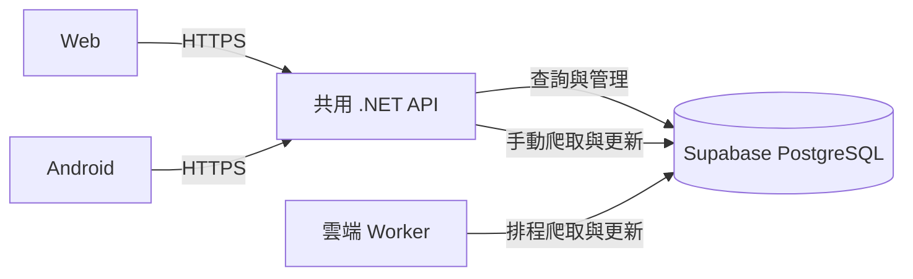

# HouseLens Web 與 Android 共用資料架構

日期：2026-10-31。使用者已確認採用「Web 與 Android 共用現有 .NET API，由後端統一存取 Supabase PostgreSQL」。本文件記錄第一版需求、共用資料的邊界及後續實作前待選的項目，供架構檢閱；目前工作範圍是設計，尚未開始 Android 開發或雲端部署。

## 已確認的需求

| 項目 | 第一版決定 |
| --- | --- |
| 使用者 | 使用者本人與家人／少數人，共用同一組房源及設定。 |
| 權限 | 所有成員都能修改設定、操作爬蟲及刪除資料。 |
| 持續運作 | API 與爬蟲部署至持續運作的主機；使用者的電腦關機後仍可使用。 |
| 收藏 | 各裝置獨立，第一版不做跨裝置或成員間同步。 |
| 資料更新 | 開啟頁面或手動重新整理時取得最新資料，需連網使用。 |
| 共用方式 | Web 與 Android 呼叫同一套現有 .NET API。 |

成功的結果是：任何成員在任一端儲存共用設定後，其他成員重新查詢就能看到；爬蟲產生的房源、價格歷史與評分也由兩端讀取同一份資料。

## 方案比較與選擇

| 方案 | 優點 | 成本與限制 | 決定 |
| --- | --- | --- | --- |
| 共用現有 .NET API | 保留既有查詢、評分、爬蟲及清理規則，Web 與 Android 遵守同一份 API 契約。 | 需部署 API／Worker，補上登入及成員授權。 | 使用者已選擇。 |
| 客戶端直接使用 Supabase Data API | 可由 Supabase 提供資料存取端點。 | 需設定 exposed schema、資料庫 grants 與 RLS，重新界定業務規則；爬蟲管理仍需後端。 | 第一版不採用。 |

Supabase Data API 的 grants 決定可存取的資料庫物件，RLS 決定可操作的資料列，兩者需要配合設定。[官方資料存取安全說明](https://supabase.com/docs/guides/api/securing-your-api)

## 共用資料流

API 與 Worker 使用同一個 PostgreSQL 資料庫及 `houselens` schema。資料庫是共用資料的唯一持久來源；裝置透過 API 查詢及提交修改，不持有資料庫管理憑證。

第一版沿用 API 執行手動爬取、Worker 執行排程爬取的分工，兩者須遵守下述共用鎖定規則。這是本設計提出的最小改動方式；如果日後需要工作排隊、失敗自動重試或多個執行節點，再評估集中至 Worker 的持久工作佇列。

## 資料歸屬與畫面更新

| 資料 | 存放與共用方式 |
| --- | --- |
| 房源、來源刊登、價格歷史 | 沿用既有資料表，全員共用。 |
| 地區爬取條件、平台爬取篩選、追蹤條件 | 沿用既有設定表，全員共用，影響後續爬取。 |
| 評分權重、大降價門檻、房源分數 | 全員使用同一套設定及結果，不新增個人評分模型。 |
| 爬取輪次與各平台結果 | 存於 PostgreSQL，兩端透過 API 查詢。 |
| 列表價格、地區、排序與分頁等查詢條件 | 保持每個客戶端獨立，僅影響當次查詢，不修改共用爬取設定。 |
| 收藏 | Web 保留既有 `localStorage`；Android 採裝置本機儲存，不新增收藏 API 或資料表。 |

例如，成員 A 把某區的爬取總價上限改為 900 萬，API 成功儲存後，成員 B 重新查詢設定頁即可看到 900 萬。B 在列表暫時選擇「800 萬以下」，只改變自己的查詢結果。

寫入成功後，操作端重新取得伺服器回傳或重查資料；其他端於下次開啟或手動重新整理時更新。失敗時保留輸入並顯示錯誤，不把失敗的寫入呈現為已儲存。第一版不提供離線寫入、自動背景同步或即時資料訂閱。

本設計建議維持現有設定 API 的覆寫方式：同一設定由最後成功儲存的請求生效，不新增多人即時編輯或合併機制。共用設定頁應讓成員理解修改會影響所有人。

目前儲存評分權重只會更新設定，既有房源分數要等爬取流程重算才更新。第一版保留這個行為，畫面須說明重算時機，避免把「設定已共用」誤認為「排名已立即重算」。

## 登入與成員授權

本設計建議每人各自登入，僅允許受邀成員存取。所有有效成員具有相同業務權限，不分檢視者與管理者；未登入或不在有效成員名單中的身分不能存取房源與管理端點。移除成員後，即使其登入憑證尚未到期，也不能繼續呼叫業務 API。

以登入供應商的穩定使用者 ID 對應伺服器端有效成員名單。第一版可由維運者管理名單，不需要新增邀請管理介面，也不需要在每張房源表加上 `UserId` 或 `TenantId`。這個設計只服務同一組人；未來若要讓不同家庭各有私有資料，須另外設計資料隔離。

登入供應商尚未選定。Supabase Auth 是候選方案，可負責登入並發出 JWT，.NET API 驗證簽章、發行者、接收者與有效期限，再檢查成員資格。使用 Auth 不代表要讓客戶端改用 Supabase Data API，也不代表現有 EF 資料庫連線會自動套用使用者的 RLS。[Supabase Auth](https://supabase.com/docs/guides/auth)、[ASP.NET Core JWT 驗證](https://learn.microsoft.com/en-us/aspnet/core/security/authentication/configure-jwt-bearer-authentication?view=aspnetcore-10.0)

授權範圍涵蓋房源、分析、設定、爬取結果、圖片代理及管理操作；保留的 SSE 端點同樣要納入。健康檢查只回傳必要的服務狀態。圖片載入與事件串流的登入憑證傳遞方式須配合客戶端選型設計，不能只在一般 API 請求加上憑證就視為全部完成。CORS 僅處理瀏覽器跨來源存取，不能取代登入或成員授權。

## 爬蟲與清除資料的協調

現有 API 使用程序內 `SemaphoreSlim`，Worker 使用 Quartz 的工作防重入機制，兩者不共用鎖。搬到雲端後，即使各只啟動一個程序，手動爬取仍可能與排程同時執行。

第一版設計要求所有完整爬取、單平台重新爬取及平台清除共用一把跨程序鎖。建議沿用 PostgreSQL，使用與 migration 初始化鎖不同的 advisory lock key，不另建 Redis 服務。鎖須覆蓋整個操作，維持持鎖的資料庫 session，並在所有完成及失敗路徑正確釋放；細節留給實作者及整合測試確認。

| 情況 | 預期行為 |
| --- | --- |
| 成員在忙碌時觸發爬取或清除 | 回傳衝突狀態及可理解的訊息，不排隊、不執行第二個操作。 |
| 排程觸發時已有手動爬取或清除 | 略過該次排程並記錄原因，避免重疊執行。 |
| 手動請求被接受 | 表示工作已接受，不表示爬取已完成；後續由持久輪次結果判斷。 |
| 執行失敗或主機重啟 | 將已開始但中斷的輪次辨識為失敗／中斷，避免永久顯示 Running；第一版不自動重試。恢復機制須避免把另一個仍執行中的程序誤判為中斷。 |

清除資料影響所有成員；兩端應保留明確的操作範圍與刪除確認。此設計不改變既有平台清理的業務範圍，也不安排立即執行清理或爬取。

目前細部爬取進度存於各程序的 `CrawlProgressState`；共用 PostgreSQL 不會自動共用它。第一版以持久的輪次與平台結果供兩端重新查詢，不承諾提供 Worker 的逐區即時進度。既有 API 手動爬取的 SSE 若保留，應清楚限制其代表的執行來源。

## 部署與客戶端契約

本設計建議第一版部署一個 API 程序及一個 Worker 程序，可放在同一台持續運作的主機，減少維運工作。主機須能執行 .NET 10、Playwright 所需瀏覽器與相依套件，並支援背景排程、程序重啟及持久日誌。具體供應商、規格及預算待選；不把持續運作等同於零停機保證。

Web 可由同一 HTTPS 網域提供靜態檔與 `/api` 反向代理，保留相對路徑。Android 設定正式 HTTPS API 基底網址，不依賴開發電腦的 `localhost`。圖片代理路徑要能解析到同一個 API 來源，並與授權方式相容。

兩端沿用目前 API 的房源 ID、欄位、分頁及時間格式；時間繼續使用帶 `Z` 的 UTC，金額單位沿用萬元，坪數單位沿用坪。新增成員驗證、錯誤處理及輪次失敗表示時，同步調整兩端契約。

資料庫連線字串、LINE Token 及登入管理密鑰只放在後端環境設定。維持既有 PostgreSQL TLS 驗證與 schema，不重做遷移或匯入舊 SQLite 房源。部署時確認排程時區為預期的台灣時間，並驗證既有預設排程不會因主機時區改變而偏移。

## 第一版範圍與後續選項

第一版保留現有 Web 功能，建立 Android 存取共用 API 所需的登入、查詢與管理能力。所有成員都可操作爬蟲及清除資料，不因使用 Android 而降為僅讀。Android 的畫面配置與發佈方式需在客戶端設計時補齊。

第一版不增加跨裝置收藏、個人評分、多家庭隔離、離線編輯、即時共編或新的手機推播系統。既有 LINE 通知行為維持原有範圍，不因新增家人成員而自動擴大收件者。

| 待選項目 | 決策時機與影響 |
| --- | --- |
| 登入供應商及登入方式 | 實作驗證前決定。Supabase Auth 為候選；Google 登入或其他方式尚未選定。 |
| 主機供應商、預算、網域 | 部署計畫前決定，影響費用、機密設定、備份及程序管理方式。 |
| Android 技術及安裝方式 | Android 實作計畫前決定，影響 UI 重用、憑證儲存及交付方式，不改變共用 API 架構。 |

以上項目仍待選定，目前沒有購買或部署服務。其餘實作細節，例如成員名單的儲存格式、共用鎖的封裝位置、重啟後辨識中斷工作的方式及測試 fixture，可由實作者依現有專案慣例決定。

## 驗收情境

後續實作應以以下情境驗證，這些是驗收要求，不是已完成的測試結果。

1. 成員 A 在 Web 修改共用設定，成員 B 在 Android 重新查詢後看到相同值；兩端使用同一份房源與價格歷史。
2. 不同成員均能修改設定、觸發爬取及清除指定平台資料；未登入、非成員及停用成員的存取被拒絕。
3. Web 與 Android 的查詢篩選及收藏保持獨立，重新查詢共用資料不覆蓋本機收藏。
4. 手動爬取、Worker 排程及平台清除並發時，最多一個操作執行；失敗釋放鎖後可以再次操作。
5. 中斷的輪次不會永久顯示執行中，重啟恢復不會誤標仍在另一程序執行的工作。
6. 使用者的電腦關機後，外部手機仍可透過 HTTPS 讀取及管理資料，雲端排程依台灣時間執行。
7. 圖片、登入過期及 API 錯誤在兩端正常處理；開啟或手動重新整理時取得最新值，不把連線失敗顯示為儲存成功。

## 專案依據

- [交接文件](../../../handoff/1.md)
- [資料模型與既有行為](../../er-model.md)
- [PostgreSQL 遷移紀錄](../plans/2026-10-31-supabase-postgresql.md)
- [前端 API 與圖片代理網址](../../../frontend/src/services/api.ts)
- [前端列表篩選](../../../frontend/src/stores/filters.ts)
- [現有本機收藏](../../../frontend/src/components/PropertyCard.vue)
- [API 初始化](../../../backend/src/HouseLens.Api/Program.cs)
- [共用設定端點](../../../backend/src/HouseLens.Api/Endpoints/ConfigEndpoints.cs)
- [手動爬取與清除](../../../backend/src/HouseLens.Api/Endpoints/AdminEndpoints.cs)
- [爬取流程](../../../backend/src/HouseLens.Application/Crawling/CrawlOrchestrator.cs)
- [Worker 排程工作](../../../backend/src/HouseLens.Worker/CrawlJob.cs)
- [程序內進度](../../../backend/src/HouseLens.Application/Crawling/CrawlProgressState.cs)
